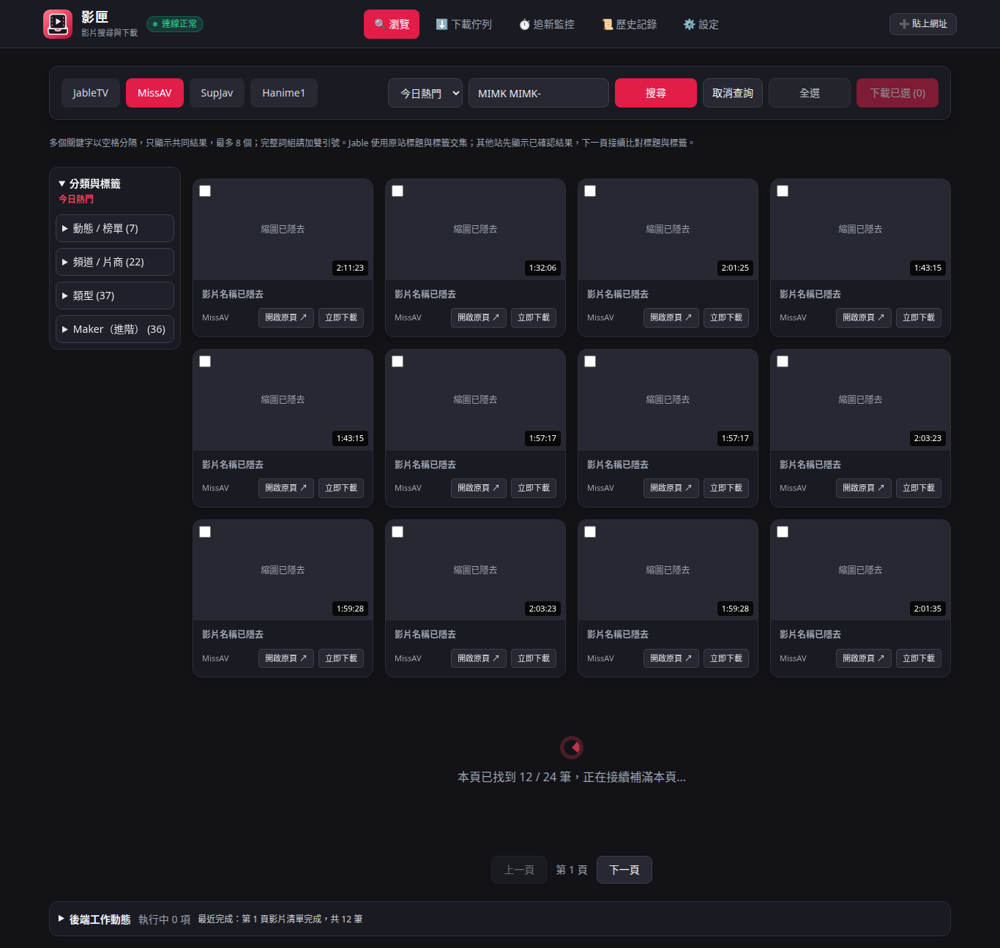
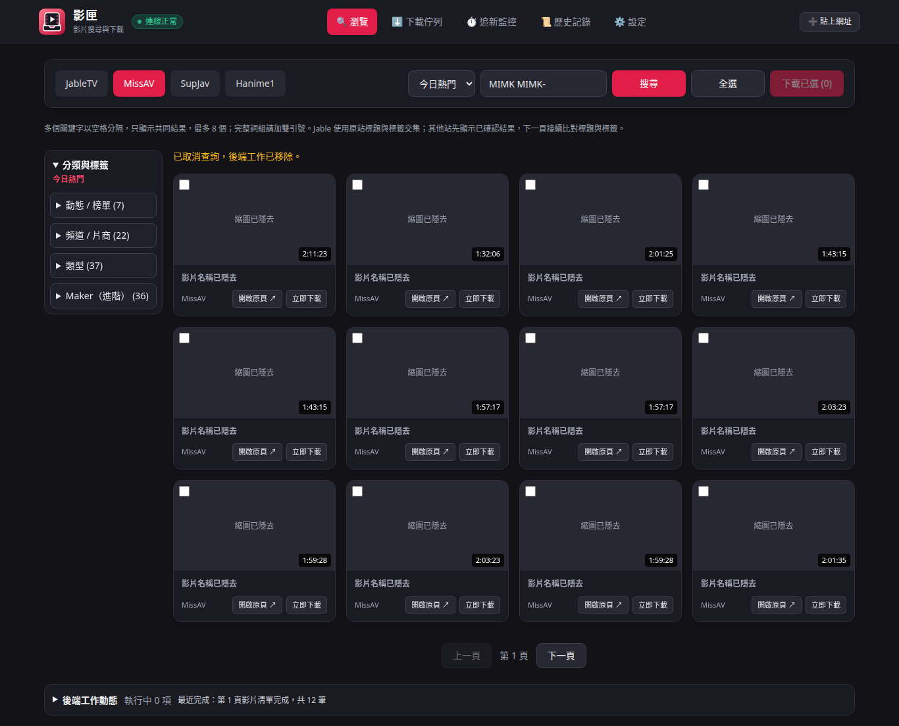
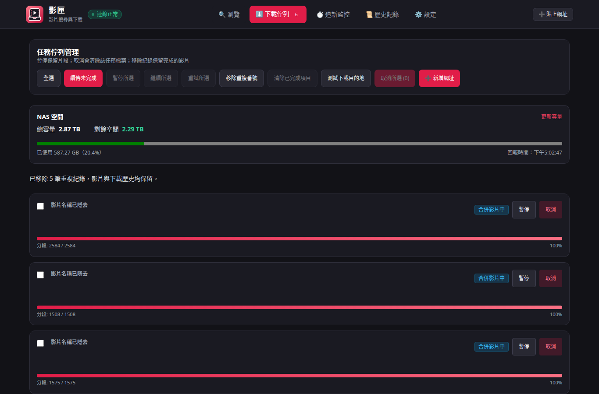
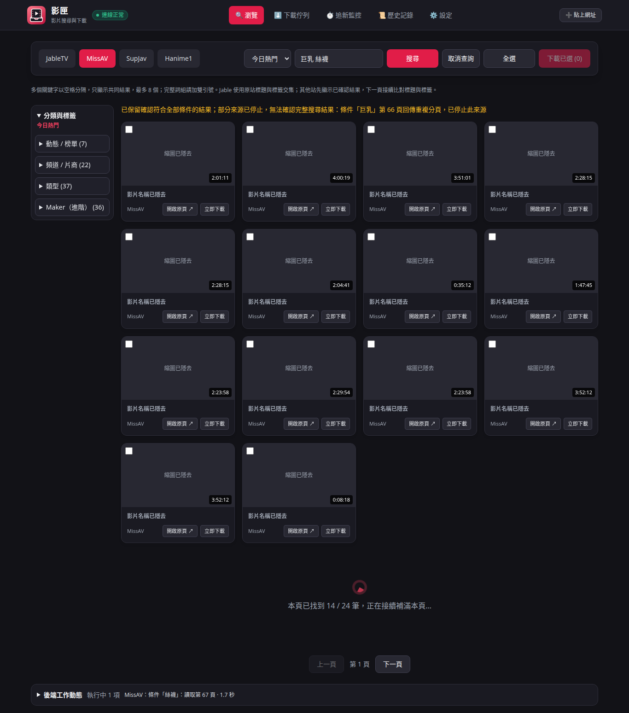

# 影匣

影匣是以繁體中文使用者為主的影片搜尋與下載工具，[專案原始碼](https://github.com/CloudWorkTools/UAV-Downloader)包含 Web 介面與 NAS 儲存擴充。專案沿用 [Alos21750/UAV-Downloader](https://github.com/Alos21750/UAV-Downloader) 的下載核心，將瀏覽、複選下載、下載佇列及 SMB 儲存整合到瀏覽器。

## 主要功能

| 功能 | 操作與行為 |
| --- | --- |
| 四站瀏覽與搜尋 | 支援 JableTV、MissAV、SupJav、Hanime1，搜尋條件包含標題與標籤。 |
| 多關鍵字交集 | Jable 沿用原站分頁；其他站先顯示已確認結果，再接續補滿每頁 24 筆，按下一頁才繼續。任一條件確認完全沒有結果就結束交集查詢。 |
| 取消查詢 | 搜尋中可取消，後端移除該查詢的工作與進度；切換網站、分類或重新搜尋也會取消舊查詢。 |
| 下載管理 | 跨頁複選、批次加入、免勾選「續傳未完成」（含等待中的項目）、暫停、繼續、失敗重試及取消後重新開始；目前下載中的項目排在前面，加入下載後仍留在瀏覽頁。 |
| 保留檔案的清單整理 | 「清除已完成項目」只移除已完成紀錄；「移除重複番號」清除已略過的重複紀錄與同番號的多餘紀錄，保留執行中與可續傳任務。兩者都保留影片與下載歷史。 |
| 後端工作動態 | 底部面板預設收起，摘要仍定時更新；展開可橫向查看各條件及下載階段的進度。 |
| 獨立 Firecrawl | Docker 專屬擷取服務預設啟用，站台連線失敗時使用；可開關並測試目前站台，不連接本機 MCP。 |
| Docker AI 字幕 | 同機 Speaches 辨識日文，本機翻譯為英文／繁中，提供快速／平衡／精細品質選項；可設定外部音訊辨識 API，字幕失敗可獨立重試，詳見 [字幕設定](docs/web-ui.md#docker-ai-字幕)。 |
| NAS / SMB | 支援直接寫入 NAS、系統掛載目錄，以及先下載到本機再傳送；NAS 有回報容量時，顯示總容量、剩餘空間與使用比例。 |

來源重複分頁或接續載入中斷時，會保留已確認的結果並顯示原因；部分來源停止時不宣稱已找到全部影片。

搜尋取消與來源限制、下載操作及儲存設定詳見 [Web 與 NAS 使用說明](docs/web-ui.md)。

## 介面預覽

以下為實際部署的 Web 介面。截圖已隱去影片縮圖、名稱及下載任務細節。

搜尋先顯示確認的交集結果，接續補滿同一頁；搜尋列提供「取消查詢」，底部保留工作動態摘要。



<details>
<summary>查看取消查詢後的畫面</summary>

取消成功後顯示「後端工作已移除」，不再接續載入；已顯示的影片仍可瀏覽。



</details>

<details>
<summary>查看下載清單與管理按鈕</summary>

下載清單提供免勾選的「續傳未完成」、批次暫停、繼續、重試、取消、目的地測試，以及保留影片的「移除重複番號」與「清除已完成項目」。



</details>

<details>
<summary>查看來源重複分頁時保留結果的畫面</summary>

來源重複分頁時，提示停止該來源並保留已確認的交集；其他來源仍可繼續比對。部分來源停止時，不能把目前筆數當成完整總數。



</details>

## 本機啟動

需要 Docker Compose 與 Buildx。唯一的啟動檔是 [docker-compose.yml](docker-compose.yml)，包含 Web、Speaches、獨立 Firecrawl 與其資料服務。第一次建置會下載 Rust、Python、FFmpeg 與 Firecrawl 的依賴。

第一次使用時，在專案目錄建立資料庫密碼；已有 `.env` 時沿用原檔，保留密碼以便連接既有資料卷：

```bash
(umask 077; test -e .env || python3 -c 'import secrets; print("FIRECRAWL_POSTGRES_PASSWORD=" + secrets.token_urlsafe(40))' > .env)
```

在服務主機啟動全部功能：

```bash
docker compose up -d --build --wait
```

開啟 **<http://127.0.0.1:8080>**。Firecrawl 預設啟用，使用專屬 Docker 網路，不連接本機 MCP。
下載、設定與模型資料分別保存在專案下的 `downloads/`、`config/`、`appdata/`；Speaches 模型與 Firecrawl 資料保存在 Docker 資料卷。

驗證服務：

```bash
curl --fail http://127.0.0.1:8080/api/status
```

回應中的 `status` 應為 `ok`。在設定頁按「儲存並測試目前站台」，確認 Firecrawl 能實際擷取該站。
停止全部服務使用 `docker compose down`，重啟使用 `docker compose up -d`；資料仍會保留。請勿加上 `down -v`，該選項會刪除 Firecrawl 資料卷。

Web 介面目前沒有登入驗證，因此預設只開放本機連線。遠端使用前，請先在外層配置 HTTPS 與存取驗證。
遠端部署使用 `python3 scripts/deploy_remote.py`，本機僅建置映像；該流程會沿用遠端既有設定與資料卷。

## 瀏覽與批次下載

1. 選擇網站與分類，或輸入關鍵字搜尋。
2. 使用搜尋列旁的「全選」選取目前頁面的影片，也可逐片勾選。
3. 按「下載已選」加入下載佇列。
4. 在「下載佇列」查看進度、暫停、繼續、重試或取消任務。

「取消全選」只取消目前頁面的選取。跨頁已選影片仍會保留；加入佇列失敗的影片會維持選取，方便重試。

## NAS / SMB 設定

在「系統設定」的「下載儲存位置」選擇：

- **透過 SMB 直接儲存至 NAS**：填寫 NAS 位址、帳號與密碼，直接以 SMB 寫入分段與影片，不需預先掛載。支援 `smb://nas.local/download` 或 `nas.local/download`。
- **使用系統已掛載的 NAS 路徑（進階）**：填入系統已掛載的 NAS 路徑，例如容器內的 `/nas`。影片分段、合成檔與字幕都寫入 NAS，不先保留完整影片到本機。未掛載或已存在同名影片時會停止下載。
- **先下載到本機，再以 SMB 傳送至 NAS**：填寫 NAS IP／主機名稱或 SMB 網址，並分開填寫帳號、密碼。網址可省略 `smb://`；網址內的共享資料夾與子目錄會優先套用。完成後傳送，保留本機檔案。
- **本機目錄**：使用一般本機下載目錄。

先按「測試連線」，再按「儲存設定」。SMB 直接儲存與下載後傳送都使用表單的帳密；只有進階掛載模式使用作業系統掛載。Docker 掛載方式見 [Web 與 NAS 使用說明](docs/web-ui.md)。

密碼會加密保存在掛載的 `/config`，網頁只顯示是否已保存。重新編輯時留空可沿用密碼；變更 NAS 位址或帳號時須重新輸入。備份設定時請一併保留 `nas.json` 與 `nas.key`，並限制備份的讀取權限。能讀取這兩個檔案的系統管理者仍可解密密碼。

NAS 下載鎖會在連線或程序結束後釋放；舊版殘留且未被持有的鎖可在重試時恢復使用，不需手動刪除。仍在使用中的鎖與既有影片會受到保護。

詳細操作與限制見 [Web 與 NAS 使用說明](docs/web-ui.md)。

## 模組分工

| 範圍 | 位置 | 責任 |
| --- | --- | --- |
| 原作者下載核心 | `src/uav_downloader/sites/`、`core/`、`subtitles/` | 網站解析、下載與字幕 |
| Web HTTP 與靜態頁面 | `uav-web/` | Rust 網頁服務、JSON API 轉接、瀏覽介面 |
| 背景任務 | `src/uav_downloader/daemon/` | 下載佇列及下載核心的銜接 |
| NAS 擴充 | `src/uav_downloader/daemon/nas.py` | SMB 連線、掛載驗證、加密保存與完成檔案傳送 |
| 批次選取介面 | `uav-web/frontend/video-selection.js` | 全選、跨頁選取與批次送出 |
| NAS 設定介面 | `uav-web/frontend/nas-settings.js` | NAS 表單、密碼保存狀態與連線測試 |

各網站共用儲存介面，解析程式不接觸 NAS 帳密；任務管理器負責選擇原生 SMB、系統掛載或下載後傳送模式。模組責任與新增功能規範見 [架構說明](docs/architecture.md)及 [貢獻指南](CONTRIBUTING.md)。

## 上游更新

GitHub Actions 每天於臺灣時間 **09:17、21:17** 比較原作者 `master` 的已提交更新與本專案主分支，不以原作者的 PR 作為更新依據。

每次執行會列出雙方版本、獨有提交、受影響模組、檔案差異與合併衝突，並更新固定的差異追蹤 Issue 及 Actions 摘要。只有文件／圖表更新時建議暫緩同步；功能或建置變更則進入整合與相容性檢查。工作流程不會自動建立同步 PR 或合併更新，GitHub 排程可能延遲。

流程與判斷依據見 [上游更新維護](docs/upstream-sync.md)。

## 開發與檢查

```bash
python3 -m venv .venv
.venv/bin/python -m pip install -r requirements-docker.txt pytest PySocks customtkinter Pillow
.venv/bin/python -m pytest -q tests/test_nas.py tests/test_daemon.py tests/test_proxy.py tests/test_storage_failures.py tests/test_resolution_pref.py
node tests/web_ui.cjs
node tests/web_browse.cjs
node tests/web_nas_space.cjs
bash scripts/check_web_container.sh uav-downloader:local
```

桌面版原有測試另有 GUI 與 AI 依賴；上方為 Web 擴充使用的檢查集合。

## 原作者與授權

下載核心與原有桌面工具來自 [Alos21750/UAV-Downloader](https://github.com/Alos21750/UAV-Downloader)，沿用 [Apache License 2.0](LICENSE) 並保留原有著作權與第三方聲明。原作者的 Windows 執行檔請至[上游 Releases](https://github.com/Alos21750/UAV-Downloader/releases)取得，並參閱[桌面版文件](docs/README.md)。這些發行檔不包含本專案的 Web／NAS 擴充。
