# Web 與 NAS 使用說明

本文件說明 CloudWorkTools 版本的瀏覽器操作與 SMB 儲存。啟動步驟以[專案首頁](../README.md#人類安裝)為準；桌面工具另見 [UAV Browser](uav-browser.md)。

實際搜尋、取消查詢與下載管理的截圖見[介面預覽](../README.md#介面預覽)，其中影片內容與任務細節已隱去。

## 瀏覽與選取

電腦版搜尋列提供分類、關鍵字搜尋、全選與下載按鈕。手機版（畫面寬度小於 640px）保留搜尋操作，將全選、下載已選與清除勾選收進右下角的人像功能選單；這個入口使用女孩頭像，與頁首的女孩電影盒品牌圖示不同。頭像右上角顯示跨頁已選影片數，選單的圓形按鈕只顯示目前可用的操作；全選後重新開啟選單即可下載。

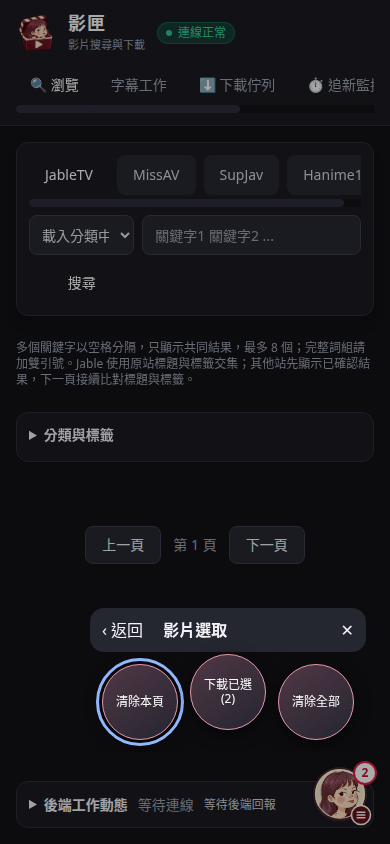

在手機版下載佇列，人像選單分為「新增任務」、「批次處理」與「佇列整理」。先在批次處理開啟選取模式，勾選任務後再開啟選單執行暫停、續傳、重試或其他適用操作。選單同步顯示目前選取數量與可用狀態，每層提供返回與關閉，也可點遮罩關閉。電腦版保留原有按鈕位置。

「全選」選取目前頁面的影片；全部選取後，按鈕會變成「取消全選」。下載按鈕會顯示已選數量，並在確認儲存位置後將跨頁選取的影片整批加入佇列。送出期間不能重複送出；失敗項目會保持選取。加入下載後會留在目前頁面，保留搜尋條件與頁碼。

## 下載資料夾確認

按「下載已選」、單片下載或快速貼上網址後，確認視窗會同時列出「使用目前設定的下載路徑」與「以搜尋條件建立資料夾」。前者顯示目前實際目的地；後者在該目的地下建立子資料夾。資料夾名稱預填產生本頁結果的搜尋條件，可直接確認，也可在輸入欄位修改；沒有搜尋條件時使用日期名稱。「本次儲存位置」隨選項與名稱更新，設定中的上層下載位置保持不變。

瀏覽器會記住上次選擇的儲存方式，包括關閉視窗前的選擇。下次下載自動預選該方式；選擇搜尋資料夾時，名稱依本次搜尋重新預填。記憶保存在目前瀏覽器，清除網站資料會重設選擇，其他瀏覽器各自保存。瀏覽器禁止保存時，同一頁面仍會記住選擇。

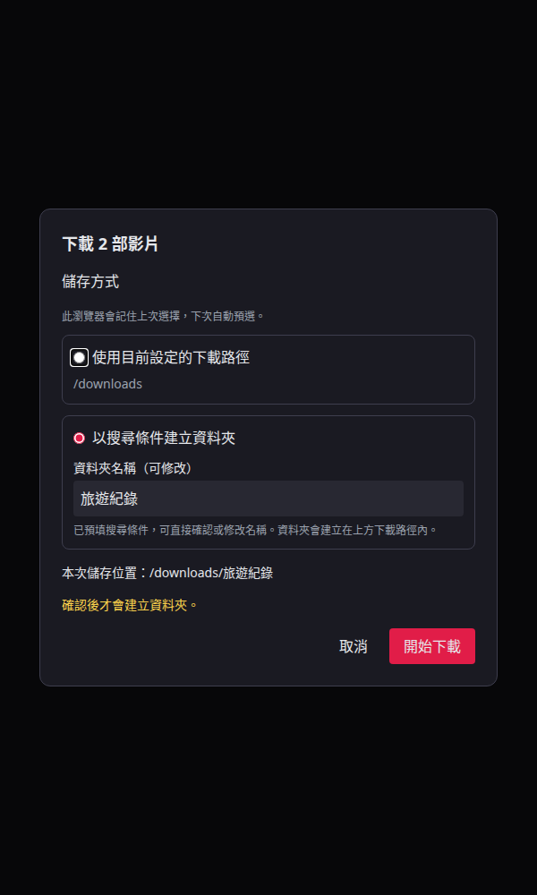

同名資料夾已存在時，可選日期後綴、流水號或自行修改名稱建立新資料夾，也可存入既有資料夾並略過已有影片。「覆寫同名檔案」只取代本次產生的同名檔案，保留其他檔案；實際檔名須解析影片後才能確認。按鈕會顯示「覆寫並下載」，已覆寫的內容不會因取消而還原。目的地有一般未完成任務時，可選「存入既有資料夾、略過已有影片」繼續追加；未完成的相同影片會略過，原任務保持不變。若同資料夾有未完成的覆寫任務，須等該任務結束後才能追加；覆寫模式也不能在其他任務未完成時提交。

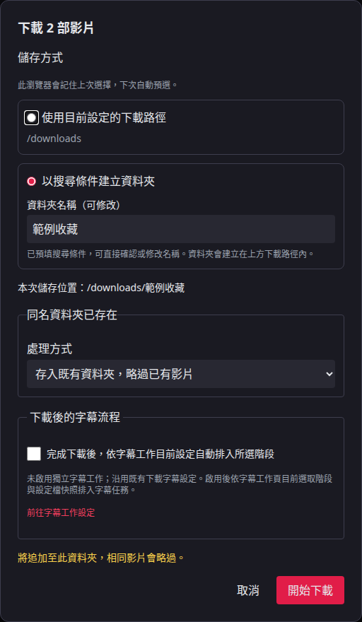

整批影片共用一次確認與同一個目的地；確認前不建立資料夾，取消不加入任務。新資料夾可重新收取已有完成歷史的影片，未完成的相同影片仍受去重保護。續傳與失敗重試沿用原任務資料夾，不另開確認視窗。操作由前端 `download-batch.js` 與後端 `daemon/download_batch.py` 處理，離線回歸測試涵蓋選擇記憶、同名處理及本機與 NAS 目的地。

## Docker AI 字幕

Web 下載完成後可呼叫同機 Speaches 辨識日文，再以本機翻譯模型產生英文或繁體中文字幕。
在設定頁啟用「AI 自動生成字幕」並選擇字幕語言；輸出為影片旁的 `.ja.srt`、`.en.srt` 或 `.zh-TW.srt`，不修改 MP4。

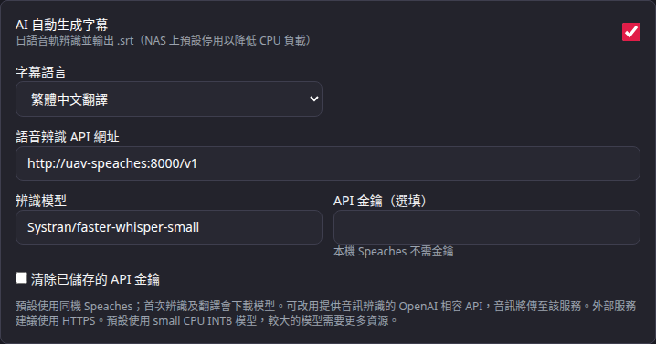

預設辨識網址為 `http://uav-speaches:8000/v1`，模型為 `Systran/faster-whisper-small`。
[docker-compose.yml](../docker-compose.yml) 啟動 CPU INT8 Speaches，不對主機公開服務連接埠，並限制容器記憶體為 2 GB。
首次辨識時服務下載所選模型，快取保存在 `speaches-models` Docker 資料卷；本機翻譯模型也在首次需要時下載。
辨識每次送出有限長度的音訊片段，合併時保留影片時間。

small 模型使用 CPU INT8 辨識，但實際速度與日文辨識品質取決於 CPU、音訊及其他服務負載。
改用較大的模型時，須同時確認 Speaches 的記憶體限制與主機可用資源；預設限制不保證能執行所有模型。

「本機翻譯品質」可選快速、平衡或精細，預設平衡。
三檔使用相同翻譯模型，分別搜尋 1、4、8 個候選；精細模式較耗 CPU、記憶體與時間，不保證每句都更準。
此設定只影響本機英文與繁中翻譯，不影響日文語音辨識，也不調整外部翻譯 API。
儲存後，新開始的字幕工作採用新品質；執行中的工作維持啟動時的設定。
完成的翻譯任務可按「重新產生字幕」套用新品質，沿用既有日文字幕與 MP4。
切換品質會區分翻譯快取，並更新應用程式產生的舊翻譯；使用者修改過或來源不明的字幕仍保留。
未選擇覆寫的下載後傳送任務會保留 NAS 上的同名字幕，須另行處理舊檔。

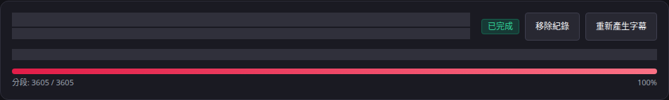

外接服務在同一區塊設定「語音辨識 API 網址」、「辨識模型」及選填的「API 金鑰」。
網址填入以 `/v1` 結尾的 base URL，服務須提供 OpenAI 相容的 `/audio/transcriptions`，並回傳附時間戳的 `verbose_json`。
只有文字聊天 API 的服務無法辨識音訊；外部服務需要自行安裝或提供所選模型。
跨主機建議使用 HTTPS，音訊會傳送至指定服務。

金鑰加密保存在 `/config/asr.json`，加密金鑰為 `/config/asr.key`，兩者須一起備份並限制存取。
保存後留空可沿用金鑰，改變 API 網址會清除原有金鑰，避免傳給另一個服務；可勾選「清除已儲存的 API 金鑰」。
無人值守部署也可用 `UAV_ASR_API_KEY` 環境變數提供金鑰，清除保存的金鑰不會移除環境變數。

API 無法連線、模型下載或翻譯失敗時，任務保留 MP4 並顯示字幕錯誤。
使用者修改過或來源不明的既有字幕會保留；更改辨識模型或端點會讓應用程式自行產生的舊字幕重新辨識。
字幕處理中的取消會終止 UAV 的辨識請求程序，外部服務已開始的運算是否立即停止取決於供應商。

尾端時間戳超出音訊範圍時，系統會重新辨識最後一段實際音訊，再裁切回有效時間。
正常片段保留；負數、倒序、非數值或超出一個重辨識視窗的時間戳仍會報錯。
預設維持 120 秒分段與兩側重疊，異常尾段改以 30 秒視窗辨識。
較短的全片分段不保證文字更準，且會增加請求次數。

字幕失敗的已完成任務提供「重試字幕」，沿用現有 MP4，只重跑字幕流程。

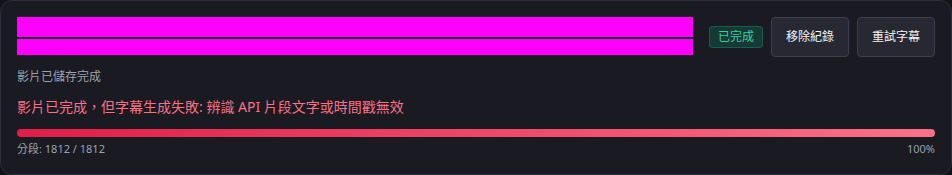
已成功的辨識片段依音訊內容、模型與 API 網址快取在 `/config/asr-cache/`。
重試時會再次擷取音訊，並重用相同片段的辨識結果；修改模型、端點或音訊後不會誤用舊結果。
快取包含辨識文字，目錄與檔案限制存取權限，保留七天並於辨識時清理至 128 MiB。
字幕重試與取消均保留既有 MP4；下載後傳送模式只補傳字幕，同名字幕依原任務的覆寫選擇處理。

## 獨立字幕工作

「字幕工作」頁面提供四個可分開選用的階段：獨立語音活動偵測（VAD）、語音辨識（ASR）、原文後矯正及翻譯。設定檔保存服務、模型、參數及階段能力；API 金鑰不會回填到表單。LocalAI 是四階段外部服務的預設選項；文字階段也可設定 OpenAI 相容服務、Ollama 或 LM Studio。Ollama 與 LM Studio 只用於文字階段。

相容性測試及模型清單查詢會呼叫外部服務，每次操作前都會先詢問。測試結果只代表格式與服務能力回報，不表示模型品質已驗收。當停用額外思考的能力未知時，矯正或翻譯會先阻止提交；明確允許額外思考後才可繼續。Linux 部署沒有獨立本機 VAD runtime，頁面會說明原因並允許改用已設定的外部 VAD；不會下載或安裝模型 runtime。

選取下載歷史或服務端允許目錄中的影片，勾選要執行的階段及輸出語言，再按「檢視摘要並提交」。新工作預設勾選獨立 VAD 與 ASR、只輸出日文；原文後矯正及翻譯預設關閉。ASR 來源語言為日文；可選繁體中文或英文作為翻譯目標，輸出字幕也能單獨選擇日文、繁中或英文。提交前摘要列出影片名稱、各階段服務與模型、翻譯目標、輸出語言及額外思考設定。提交字幕工作不會重新下載影片。下載確認視窗也可選擇在影片下載完成後，依目前字幕設定排入字幕任務；未勾選時沿用原本下載行為。

影片清單掃描最多檢查 1,000 個目錄項目，並在掃描約 8 秒後停止開始新的項目檢查；單次檔案或 SMB 操作若已開始，仍須等該操作返回。目錄離線、無讀取權限或達到任一上限時會顯示提示。出現提示時，清單可能不完整，請先檢查連線或縮小可掃描的目錄範圍，再重新載入。

設定檔表單會依階段與服務顯示 API 契約提示：LocalAI VAD 使用 `/v1/vad` 並回傳秒單位區間；ASR 使用 OpenAI 音訊轉錄 multipart 格式及 `verbose_json` 分段時間戳；文字服務使用該服務的相容或原生聊天路徑。可填參數及思考控制依服務而異，表單會列出接受的參數名稱；服務端模型模板仍可能改變實際行為。

佇列顯示目前階段、模型快照、進度、錯誤與各語言的發布狀態。服務重啟後，待續工作需要使用者按「繼續」才會恢復。只有尚未開始的項目能套用新的設定快照。階段重做時必須明確選擇上游結果：ASR 選 VAD，矯正選 ASR，翻譯選 ASR 或矯正；沒有可讀上游時必須先完成前置階段。畫面會提示所選版本及可能過期的下游結果，不會自動執行其他階段。

字幕版本頁顯示各階段最新與上一版本、設定快照、上游版本、採用與過期狀態。矯正及翻譯預覽會並列上游內容和目前文字；已清理的內容不可再作為重做輸入。文字結果可以下載 SRT；VAD 結果可檢視、下載區間 JSON 與恢復，但不會提供 SRT 發布操作。恢復上一版本不會呼叫模型，只有填入輸出語言才會嘗試發布；遇到同名字幕時，必須另行確認是否替換。儲存失敗時，可只重試字幕保存，不重送模型請求。

字幕以旁掛檔案保存，不修改 MP4。外部模型回應內容、影片標題及 API 錯誤會以文字方式顯示。測試環境的固定回應只能驗證資料路徑與介面，不能作為真實模型辨識、矯正或翻譯品質的結論；結果仍須人工檢查。

以下畫面取自已驗證的 `5d607e9` 正式 Web 映像，使用合成影片名稱與固定模型回應；不含實際影片或 API 金鑰。

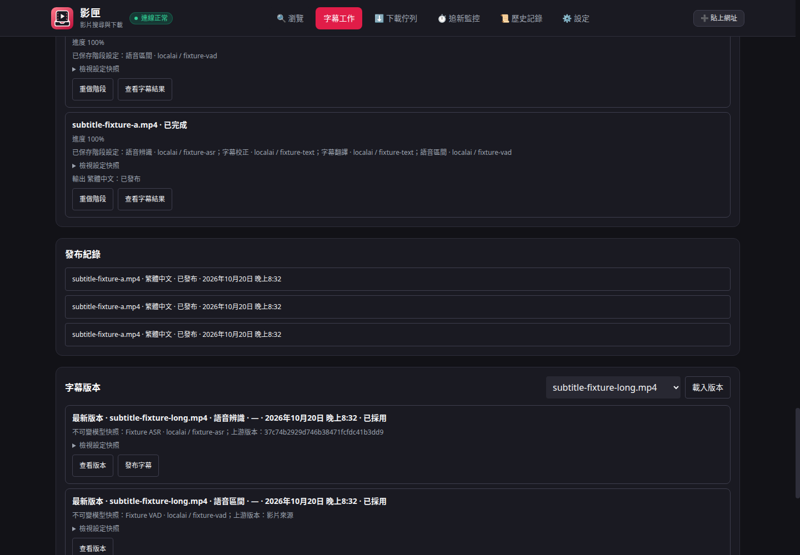

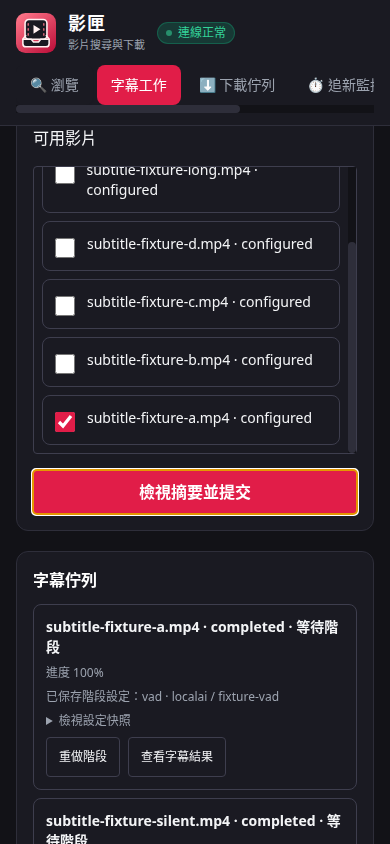


## 後端工作動態

頁面底部的「後端工作動態」預設收起，收起時仍約每秒更新目前步驟與計數，多項工作或條件每四秒輪替摘要；展開後橫向顯示工作項目，列出查詢、清單載入、Firecrawl 測試及目前下載的實際步驟。查詢會回報鏡像連線、站台限流等待、讀取頁碼及各條件的交集核對進度；總頁數未知時顯示已讀頁數與執行時間，不推算百分比。載入影片清單時，等待訊息同步顯示目前查詢的步驟。

下載會區分影片資訊解析、片段下載、片段合併、MP4 封裝及發布檔案；能計數的階段會顯示已完成與總數。面板保留最近完成或失敗的工作，連線中斷時標示畫面為最後回報狀態。工作動態只保存在記憶體，重新啟動後重新回報；下載任務紀錄仍依下載管理的規則保存。

## 精準搜尋與獨立 Firecrawl

Jable 將關鍵字交給原站的標題與標籤交集查詢，沿用原站分頁。
其他站共用接續式交集查詢，交錯讀取各條件的標題與標籤來源；找到符合全部條件的影片就先顯示，同一頁會繼續補滿 24 筆，只有確認沒有更多結果時才保留不足一頁的內容。
按「下一頁」才繼續讀取新資料；返回上一頁直接使用固定的既有結果。尚未找到符合結果時，前端會分批接續並顯示比對中，直到本頁滿 24 筆或確認搜尋完成。
查詢未完成時顯示「下一頁會接續搜尋」，不預報總筆數。進度保存在記憶體，服務重啟或查詢快取被淘汰後須重新比對。
搜尋時可按「取消查詢」，後端會移除該查詢的進度與工作紀錄，停止接續讀頁、鏡像重試與新的 Firecrawl 擷取。已送出的單次網路請求須等回應或逾時後釋放；切換站台、分類或重新搜尋也會取消舊查詢。
任一條件的標題與標籤來源全部讀完且沒有結果時，立即結束整個交集查詢，不再掃描其他條件。
查詢不再只取前 20 頁。原站重複分頁或回傳無效影片資料時，只停止該來源，其他有效的標題與標籤來源繼續比對；已確認結果會保留，並提示結果可能不完整，不回報最終總筆數。
接續載入途中連線或擷取失敗時，畫面保留本頁已確認的影片並顯示中斷原因；可返回上一頁或重新搜尋。尚無結果時才顯示整頁錯誤，不把失敗當成完整的零筆結果。
原站本身的索引完整性仍不由本應用程式保證，演算法與套件評估見[研究筆記](search-optimization-research.md)。

Docker 版的「獨立 Firecrawl 擷取服務」預設啟用，使用者保存的關閉設定仍會保留。
服務啟動時會背景測試 JableTV；設定頁區分測試中、成功與無法使用。
開啟並按「儲存並測試目前站台」，會實際擷取瀏覽頁所選站台的影片清單。
測試失敗會顯示無法使用；成功狀態只適用該站與該次測試，其他站需個別測試。
關閉並儲存後，應用程式不再呼叫 Firecrawl；Docker 服務的啟停由部署管理。

唯一的 [docker-compose.yml](../docker-compose.yml) 包含 Web 與獨立 Firecrawl 的全部常駐服務，啟動方式見[專案首頁](../README.md#人類安裝)。
此模組使用應用程式專屬的 Docker 服務，不讀取本機 MCP 的 Firecrawl 位址或資料。
`python3 scripts/deploy_remote.py` 預設在本機建置，並把獨立 Firecrawl 一起部署到設定的遠端機。
`--with-firecrawl` 保留相同預設行為；自行管理服務時可用 `--without-firecrawl` 略過附加服務安裝。
建置端需要 Docker Buildx，Firecrawl 官方 Dockerfile 使用 BuildKit 快取掛載。
部署工具要求已提交程式變更；真實主機設定仍留在 Git 忽略的本機檔案。
附加映像包含 API、瀏覽器及資料服務，需另備磁碟、記憶體與建置時間；服務埠只在專屬 Docker 網路使用。
Compose 的 readiness 不代表四站都能擷取；應以各站實際清單測試結果確認可用性。

## 下載管理

按「移除重複番號」不需勾選，會依下載器共用的番號辨識規則整理跨站、不同畫質或字幕版本的重複紀錄；無法辨識番號時，只比對相同網址，不使用相似標題合併。優先保留執行中、等待中、已暫停或持有失敗續傳資料的任務；已略過的重複紀錄也會清除，即使原任務已從清單移除、重複來源只在下載歷史或 NAS 檔案中，或清單只剩一筆已略過紀錄；其他情況優先留一筆已完成紀錄。若多筆同番號任務都需保留續傳狀態，會保留並回報筆數。此操作只移除多餘清單紀錄，不刪影片、片段、字幕或下載歷史。

下載清單依序顯示下載中、其他處理中、等待中、已暫停及已結束任務；同一組沿用原有順序，狀態更新時重新排序。

下載中或等待中的任務可按「暫停」，工作停止後顯示「繼續」；暫停保留已下載片段並釋放同時下載名額。下載或儲存失敗時會自動重試 5 次，仍失敗才顯示失敗；下載重試等待期間可取消或暫停，儲存重試期間可取消。失敗任務提供「重試」，已取消任務提供「重新開始」。這些操作沿用原任務的儲存位置、畫質、封面及字幕設定，不會新增同一任務的另一份下載。字幕處理、發布影片及 NAS 傳送期間提供取消。

按「續傳未完成」不需勾選，會將所有已暫停或失敗的任務排入下載，並檢查等待中的任務是否已在佇列、重新啟動排程；沿用原設定與已下載片段。畫面回報執行中與等待下載名額的筆數，等待項目會在名額釋出後自動開始；重複按下不會重複加入，也不會中斷正在執行的任務。已完成、已略過及已取消任務不會重新開始。部分任務因 NAS 帳號變更或重複影片而無法續傳時，會顯示原因並繼續處理其他任務。

等待中、已暫停、失敗或已取消的單項任務，可從操作選單選「立即下載」，直接開始該項任務，不受同時下載數上限限制。原有執行中的任務會繼續，設定的上限不會改變；其他等待任務仍依上限排程。相同影片去重、目的地檔案保護與續傳檢查仍會執行，重複點擊不會啟動兩次。

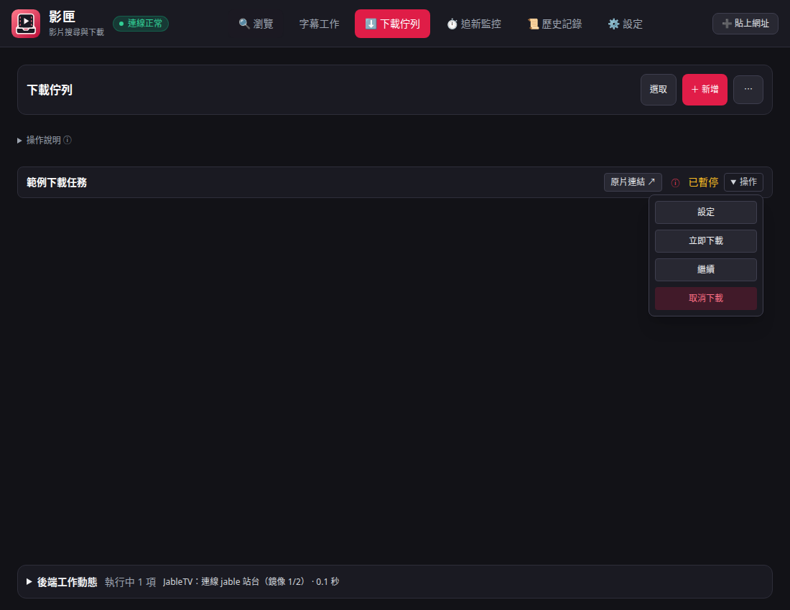

可勾選任務後批次暫停、繼續、重試或取消。「全選」包含已完成的任務；按「取消／移除所選」會開啟確認視窗，列出所選任務中「正在下載」、「已下載完成」、「等候下載」的筆數，可勾選全部或其中幾類。正在下載包含準備、字幕及傳送中；已完成包含略過；等候包含暫停、失敗及已取消。確認後會先停止所選的未完成任務，並清理可確認歸屬的檔案後移除紀錄；無法確認歸屬的檔案保留並在結果顯示筆數，供手動檢查。已完成項目只移除紀錄，保留影片與下載歷史。處理結果統一顯示於清單上方，清理失敗的項目保留供重試；仍在停止或清理中的項目會明確標示，不視為已完成。關閉確認視窗不會取消或刪除任務。後端會在清理完成或保留無法確認歸屬的檔案後移除紀錄，關閉頁面不會中止已確認的處理；服務重啟中斷清理時，任務保留為失敗供重試。

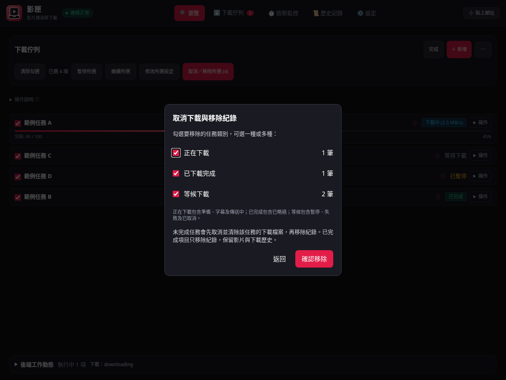

<details>
<summary>手機版取消／移除視窗</summary>

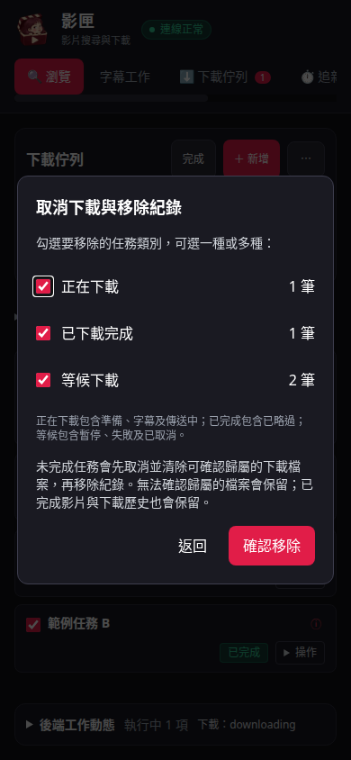

</details>

「清除已完成項目」會一次移除下載清單中已完成且工作已結束的任務紀錄，影片、封面、字幕與下載歷史均保留；執行中、已暫停、失敗、已取消及已略過的任務不受影響。

「測試下載目的地」會在目前實際目的地建立專屬測試目錄，驗證寫入、重新命名、讀回與刪除；下載開始前也會測試。下載後傳送模式會測試本機與 NAS。小檔測試通過不代表整部影片所需空間足夠。片段進度到 100% 時顯示「合併影片中」，正式檔案發布完成後才標示已完成。

服務重啟會保留任務紀錄與已知暫存目錄；已暫停任務可繼續，執行途中被中斷的任務標示失敗並提供重試。舊版紀錄若缺少暫存目錄，只在目的地找到唯一屬於該任務的目錄時續用；多份目錄會報錯。NAS 帳密由原本加密設定讀回，不會以明文寫進任務紀錄。同一個 NAS 主機、共享資料夾、帳號與模式下，變更新任務的子目錄不會阻擋舊任務重試；舊任務仍沿用原目錄與片段，不改存至新目錄。

下載管理可逐項勾選或全選，再按「取消／移除所選」選擇任務類別；字幕處理與 NAS 傳送中也可取消。任務會先顯示「取消中／清理檔案」，工作停止並清除可確認歸屬的分段、暫存、封面、影片及字幕後移除紀錄；無法確認歸屬的檔案會保留並提示手動檢查。既有檔案及已完成影片不會被刪除。若 NAS 離線導致清理失敗，任務會顯示失敗原因，恢復連線後可再次取消。失敗下載的暫存檔會保留；取消時只清理可確認歸屬的檔案。

既有 API 新增及開始下載時會依相同番號或網址檢查佇列與完成歷史，並檢查目的目錄已有的影片；同番號的不同站台、畫質、字幕或無碼版本會略過，清單顯示「已略過重複影片」。網站網址未帶番號時，會在解析標題後再檢查；無法辨識番號時只以相同網址判斷，不以近似標題自動略過。目錄檢查限設定目錄的直接子檔案，不遞迴搜尋其他資料夾。

## NAS 容量

下載清單上方顯示目前儲存設定之 NAS 目錄所在磁碟區的總容量、剩餘空間、已使用容量與比例，使用十進位 GB／TB 單位（1 TB = 1,000 GB）。NAS 有回報帳號配額限制時，另外列出此帳號的可用空間。

畫面開啟時約每分鐘讀取一次，也可按「更新容量」手動讀取。設定頁載入已儲存 NAS 的容量；按「測試連線」後顯示這次表單連線的容量，直到再次測試或載入設定，避免背景更新混用兩個 NAS 的結果。

NAS 不支援容量查詢、未回報有效數值或暫時無法讀取時，隱藏容量區塊；恢復取得有效數值後再顯示，不用零容量代替未知。容量讀取失敗不會讓已成功的連線與寫入測試變成失敗，也不停止下載。

## 選擇儲存位置

在「系統設定」的「NAS / SMB 連線」選擇「下載儲存位置」，設定套用至新加入的任務。已加入的任務沿用加入時的目的地，避免執行途中改變儲存位置。

| 模式 | 資料位置 | 連線方式 |
| --- | --- | --- |
| 本機目錄 | 本機下載目錄 | 一般檔案系統 |
| 透過 SMB 直接儲存至 NAS | NAS，包含影片分段、合成檔及最終字幕 | 使用表單保存的 SMB 帳密，不需掛載 |
| 使用系統已掛載的 NAS 路徑（進階） | NAS，包含影片分段、合成檔及字幕 | 系統已掛載的 SMB／NFS 路徑或 Windows 網路磁碟機 |
| 先下載到本機，再以 SMB 傳送 | 本機與 NAS 各一份 | 使用表單保存的 SMB 帳密 |

### 透過 SMB 直接儲存至 NAS

1. 選擇「透過 SMB 直接儲存至 NAS（帳密登入，不需掛載）」。
2. 填寫 `smb://nas.local/download` 或 `nas.local/download`，帳號與密碼分開填寫。共享資料夾須已存在；子目錄不存在時會自動建立。
3. 按「測試連線」，確認登入、寫入與刪除測試成功。
4. 按「儲存設定」加密保存帳密。新增下載會直接以 SMB 寫入 NAS，不需 Docker 掛載權限或額外磁碟映射。

分段、合併暫存及完成的 MP4 都留在 NAS。合成以 PyAV 直接讀寫 SMB 檔案，保留原始影音編碼，輸出一般 MP4，並將索引移至檔案前方（faststart）。重新封裝失敗時保留片段供重試，不會將原始串接檔當成完成的 MP4。啟用 AI 字幕時，辨識用 WAV 與處理檔暫存在服務主機，完成或失敗後清除，最終字幕寫回 NAS。模型快取仍存放在服務主機。連線失敗會停止，不會改存本機。

SMB 模式的既有正式檔案依[下載資料夾確認](#下載資料夾確認)選擇的同名處理方式保護或覆寫。播放器相容性仍應在實際 NAS 與播放器環境確認；既有下載不會自動重新封裝。

### 使用系統已掛載的 NAS 路徑（進階）

1. 先由作業系統掛載 NAS，共享目錄須可寫入。Linux 支援 CIFS／SMB3／NFS 掛載；Windows 使用 UNC 網路路徑或網路磁碟機。
2. 選擇「使用系統已掛載的 NAS 路徑（進階）」。
3. 在「NAS 掛載路徑」填入服務可存取的絕對路徑，例如 `/nas/videos` 或 `\\192.168.1.100\video`。
4. 按「測試連線」，確認掛載與寫入權限。
5. 按「儲存設定」。

Docker 須把主機已掛載的 NAS 目錄映射進容器；介面填寫容器內路徑。以下為映射範例，假設主機 `/mnt/nas` 已掛載為 NAS，並沿用首頁建立的本機下載與設定目錄：

```bash
# 掛載範例，請先依實際 NAS 完成主機掛載；未在真實 NAS 環境驗證此範例。
docker run -d --name uav-downloader-nas \
  -p 127.0.0.1:8080:8080 \
  --mount type=bind,src=/mnt/nas,dst=/nas \
  -v "$HOME/.local/share/uav-downloader-local/downloads:/downloads" \
  -v "$HOME/.local/share/uav-downloader-local/config:/config" \
  uav-downloader:local
```

若本機服務已占用 8080，先停止舊容器再啟動範例。停止此容器使用 `docker stop uav-downloader-nas`，原有掛載與檔案均保留。這個模式不會使用表單內的 SMB 帳密自動掛載 NAS；掛載及重新連線由作業系統管理。

系統會驗證路徑實際屬於網路檔案系統，並在下載開始前再次檢查。NAS 路徑不存在或未掛載時，任務停止，不會建立本機同名目錄作為替代。NAS 若是服務所在主機的實體磁碟，請使用「本機目錄」並將其資料夾映射為 `/downloads`。

### 下載後以 SMB 傳送

NAS 須提供 SMB 2 或 SMB 3 共享，預設使用 TCP 445。共享目錄須已存在，帳號須有寫入及建立子目錄的權限。

| 欄位 | 填寫方式 |
| --- | --- |
| NAS 位址 | IP、主機名稱，或 `smb://nas.local/download`；可省略 `smb://`，網址內不可含帳密 |
| 共享資料夾名稱 | 例如 `video`，不包含 IP 或斜線 |
| 子目錄 | 共享資料夾內的目錄，例如 `UAV`；可留空，不存在時自動建立 |
| 帳號 | 有寫入權限的 NAS 帳號；網域帳號可填 `DOMAIN\user` |
| 密碼 | 第一次須填寫；保存後留空可沿用 |

選擇傳送模式並填寫連線資料，先按「測試連線」，再按頁面下方的「儲存設定」。測試成功本身不會保存設定。

## 檔案與設定保存

下載後傳送模式會先下載至本機，字幕完成後再一併傳送。傳送中的任務顯示「傳送到 NAS 中」，傳送成功後才顯示完成。本機影片與字幕均保留，因此需要同時預留本機與 NAS 容量。

直接模式的既有影片依[下載資料夾確認](#下載資料夾確認)選擇的方式處理；未完成的重複任務會停止。下載與傳送使用 `.uav-*.lock` 的排他鎖，避免任務同時寫入同一個影片檔案。原生 SMB 由伺服器在檔案控制代碼關閉時刪除鎖檔；異常中止後，待 NAS 確認連線結束即可重試。舊版留下但已無連線持有的鎖檔會在取得鎖時安全續用，不需手動刪除。
進階掛載模式使用作業系統的檔案鎖，程序結束後自動釋放；空的隱藏鎖檔可繼續使用，存在本身不代表仍有下載任務。若鎖仍由其他連線持有，下載會停止並提示稍後重試；不要按檔案時間強制刪鎖。

下載後傳送模式使用暫存檔，完整寫入後才改成正式檔名。未選擇覆寫時，同名正式檔案已存在會停止傳送；明確選擇覆寫時，完整寫入後才取代該檔案。取消或傳送失敗時會嘗試清除遠端暫存檔；若 NAS 已斷線，可能仍需手動清除 `.uav-*.part`。多檔案傳送中途失敗時，已完成的遠端檔案會保留。

連線設定與加密金鑰存放在 `/config/nas.json` 與 `/config/nas.key`。請將 `/config` 掛載至持久儲存；未設定 `CONFIG_DIR` 時，使用應用程式的使用者資料目錄。服務重啟後可讀取保存的密碼，前端不會收到密碼內容。加密金鑰與設定須一起備份，且都應限制存取權限。

## 連線或傳送失敗

請先確認主機名稱解析或 IP 與 SMB 服務，再確認共享名稱、子目錄和帳號寫入權限。測試連線與下載會自動建立缺少的子目錄；NAS 共享須先建立，此介面不會修改 NAS 防火牆。

密碼無法解密時，請重新輸入密碼並保存。變更 IP 或帳號也須重新輸入密碼，避免將已保存的密碼交給其他主機或帳號。

測試失敗不會覆蓋已保存的設定。傳送失敗後可先從本機下載目錄取得影片；重新傳送前，請處理 NAS 已存在的同名檔案。

## 本機驗證範圍

原生 SMB 模式已以測試 Samba 伺服器驗證帳密登入、分段寫入、串流合成、隨機讀取播放、字幕寫入與跨連線鎖定；並已在實際 NAS 驗證完整影片下載、重疊媒體讀取、閒置鎖恢復及持有中鎖定保護。進階掛載模式已測試掛載辨識、目的地選擇、未掛載停止及同名影片保護，尚未以真實 NAS 做端到端驗證。SMB 傳送模式已以本機 Samba 伺服器驗證登入、寫入測試、保存後讀取帳密，以及 MP4／繁體中文字幕傳送。個別 NAS 廠牌、休眠喚醒、網路長時間中斷與大型影片傳送仍須在實際環境驗證。

手機版搜尋區採緊湊排列；下載確認視窗、佇列與歷史紀錄的儲存路徑可完整換行，SMB 網址編碼會還原為中文顯示，實際下載位置不變。

以下為目前前端的 390px 空資料預覽，使用示範搜尋條件：

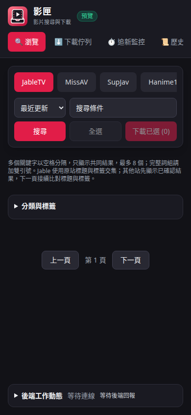

下載佇列的標題列提供「選取」、「＋新增」與更多選單；續傳所有未完成任務放在更多選單內。按「選取」後才顯示全選與適用的批次操作，按「完成」會清除勾選。操作說明可展開，批次取消下載前會提醒清除檔案。手機上的資訊提示限制於螢幕內並可捲動，錯誤訊息完整換行。

以下為目前前端的 390px 示範任務畫面：

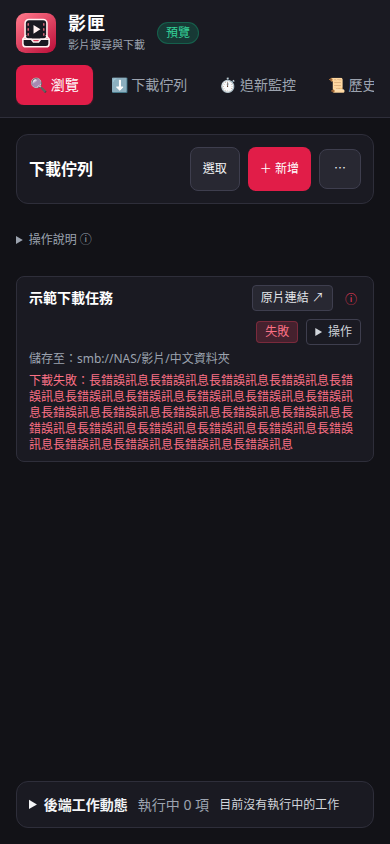

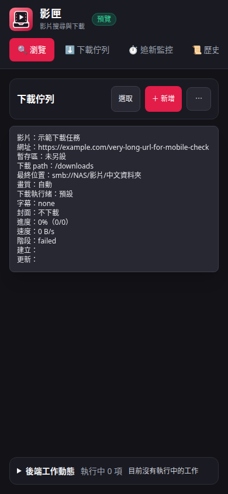
